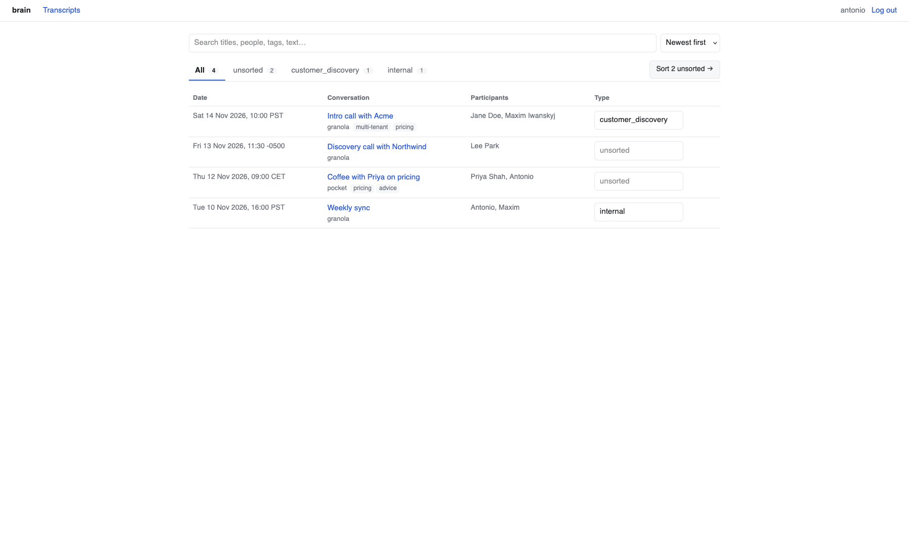

# ktx

The company context layer. Today that is **brain-server**, plus the Caddy build and deploy tooling that run it.

## brain-server

A small Go server that owns a clone of the brain git repository.
- **Upload:** you send a transcript over HTTP. The server checks its metadata, writes it to `transcripts/<type>/` (or `transcripts/unsorted/`), commits, and pushes to GitHub.
- **Web UI:** you can read, search and sort transcripts in a browser. It has no login, so keep it on a private network (on the server it is only reachable over the tailnet).

```
API client ──POST /v1/transcripts──┐
                                   ├─► brain-server ──git pull --rebase / commit / push──► GitHub
browser ──htmx──► web UI ──────────┘        │
                                            └── working copy on disk (BRAIN_WORKDIR)
```

## Transcript format

Markdown with YAML front matter between `---` lines, which GitHub and Obsidian render. `+++` is also accepted on upload. Stored files always use `---`.

```markdown
---
title: Intro call with Acme                # optional; used for the file name
date: 2026-11-14T10:00:00-08:00             # required; RFC 3339 with an offset
timezone: America/Los_Angeles               # optional IANA zone; required if date has no offset
duration_minutes: 30                        # optional
type: customer_discovery                    # optional; lowercase, [a-z0-9_-]; picks the folder
participants:                               # required; at least one, each needs name or email
  - name: Jane Doe
    email: jane@acme.com
    company: Acme
    role: CTO
  - Maxim Iwanskyj <maxim.iwanskyj@icloud.com>   # string form also works
source: granola                             # optional; required if source_id is set
source_id: not_1d3tmYTlCICgjy               # optional; makes uploads idempotent
tags: [pricing]                             # optional
---

**Jane:** ...
```

- **Other keys are kept as written.** So are comments and key order.
- **The server sets these keys:** `id`, `ingested_at` and `uploaded_by`. It overwrites any values the client sent.
- **`date` without an offset** (e.g. `2026-11-14 10:00`) is accepted only when `timezone` is set.

A full example is in [examples/transcript.md](examples/transcript.md).

### Files and ids

The path is `transcripts/<folder>/<YYYY-MM-DD>-<HHMM>-<slug>-<id>.md`.
- The date and time are the meeting's local time.
- The slug comes from `title`, or from the participants' names if there is no title.
- The folder is the `type` (e.g. `transcripts/customer_discovery/`). Without a `type`, it's `transcripts/unsorted/`.

The `id` is the first 12 hex characters of a SHA-256:
- of `source` + `source_id` if a `source_id` is given;
- otherwise, of the uploaded bytes.

**Uploading a transcript whose id already exists overwrites it.** Git keeps the old versions. The server searches all of `transcripts/` for `*-<id>.md`:
- **Identical content:** nothing is committed (`unchanged`).
- **Different content:** the file is overwritten (`updated`).
  - If the `type`, date or title changed, the file is moved or renamed in the same commit.
  - Without a `type`, the file stays in whatever folder it's in, so files you sorted by hand stay sorted.
  - `ingested_at` keeps the first ingestion time. `uploaded_by` is the latest uploader.

Moving a file by hand is fine as long as its name keeps the `-<id>.md` suffix.

## API

All requests need `Authorization: Bearer <token>`.

### `POST /v1/transcripts`

Body: the raw Markdown file (`Content-Type: text/markdown`). Maximum size is `BRAIN_MAX_UPLOAD_MB`.

```sh
curl -X POST https://brain.example.com/v1/transcripts \
  -H "Authorization: Bearer $TOKEN" -H "Content-Type: text/markdown" \
  --data-binary @examples/transcript.md
```

| Status | Meaning |
|---|---|
| `201` | New transcript. `{"id","path","result":"created","commit","pushed"}` |
| `200` | Id already existed. `result` is `updated` (with `commit`, plus `previous_path` if it moved) or `unchanged` |
| `400` | Invalid. `{"error","details":[...every problem...]}` |
| `401` | Missing or wrong token |
| `413` | Too large |

If GitHub can't be reached, the commit stays on the server. The response has `"pushed": false` and a `push_error` message. The next upload or periodic sync pushes it.

### `GET /healthz`

No auth. Returns `{"ok":true}`.

## Web UI



- **List** (`/`):
  - Search across title, participants, tags, source and the transcript text.
  - Tabs for every folder, with counts. Sort by date or title.
  - Type a type into a row's field and press Enter (or leave the field). The file moves to `transcripts/<type>/`, `type:` is updated in its front matter, and the change is committed (`Changed-By: <you>`) and pushed. Leave the field empty or type `unsorted` to move it back.
- **Transcript** (`/transcripts/<id>`):
  - Shows the metadata and the body rendered as Markdown. Raw HTML in transcripts is escaped.
  - **Save and next unsorted →** saves and jumps to the oldest remaining unsorted transcript, so you can work through the backlog. `/sort` starts there.
- **Type suggestions:** `BRAIN_TRANSCRIPT_TYPES` plus every folder that already exists. Any new name matching `[a-z0-9_-]` creates a folder.
- **Built with** [templ](https://templ.guide) components and [htmx 4](https://four.htmx.org). htmx is vendored in `internal/web/static`, so the page loads nothing from a CDN.

### No login

The UI has no authentication. Anyone who can reach it can read and re-sort transcripts. That's fine while it is only reachable over the tailnet, behind Caddy. Don't expose brain-server's port anywhere else. A central SSO can be put in front of it later; Caddy is the natural place for that.

What it keeps:
- **Cross-origin protection.** Form posts from other origins are refused (Go's `http.CrossOriginProtection`), so a website you visit can't make your browser change things here.
- **A strict Content-Security-Policy** (`script-src 'self'`, no inline or eval). Because of that, htmx features that evaluate JavaScript (`hx-on`, `js:` values, trigger filters like `keyup[key=='Enter']`) won't work. Put such behavior in `static/app.js`.
- **Some attribution.** Commits made from the UI record the client's address, as forwarded by Caddy: `Changed-By: web UI (100.64.0.3)`.

The SSH-signature login that used to be here is in git history (`internal/web/auth.go`, `internal/sshsig`) if it's ever useful again.

### Editing templates

```sh
go tool templ generate -path internal/web   # after changing views.templ; commit the generated views_templ.go
```

## Configuration

| Variable | Default | |
|---|---|---|
| `BRAIN_REPO_URL` | required | e.g. `git@github.com:org/brain.git` |
| `BRAIN_API_TOKENS` | required | `antonio:<token>,maxim:<token>`; tokens at least 24 chars (`openssl rand -hex 32`). The name goes into `uploaded_by` and the commit's `Uploaded-By:` trailer. |
| `BRAIN_SSH_KEY_PATH` | | Deploy key (private key file) |
| `BRAIN_SSH_KNOWN_HOSTS` | | Pinned `known_hosts`. Without it, the host key is trusted on first use. |
| `BRAIN_BRANCH` | `main` | |
| `BRAIN_WORKDIR` | `./data/repo` | Clone location; created on first start. Keep it on a persistent disk. |
| `BRAIN_LISTEN_ADDR` | `:8080` | |
| `BRAIN_SYNC_INTERVAL` | `5m` | Pull, and push unpushed commits, on this interval. `0` turns it off. |
| `BRAIN_GIT_AUTHOR_NAME` / `_EMAIL` | `brain-server` / `brain-server@users.noreply.github.com` | Commit author |
| `BRAIN_MAX_UPLOAD_MB` | `10` | |
| `BRAIN_TRANSCRIPT_TYPES` | `advisor,customer_discovery,investor,internal` | Type suggestions in the UI |

### Deploy key

```sh
ssh-keygen -t ed25519 -N "" -C brain-server -f deploy.key
# GitHub → repo → Settings → Deploy keys → Add deploy key: paste deploy.key.pub, tick "Allow write access"
ssh-keyscan github.com > known_hosts
# Compare against https://docs.github.com/en/authentication/keeping-your-account-and-data-secure/githubs-ssh-key-fingerprints
```

### Run

```sh
go run ./cmd/brain-server   # with the variables above set
```

```sh
docker build -t brain-server .
docker run -p 8080:8080 -v brain-data:/data \
  -v $PWD/deploy.key:/secrets/deploy.key:ro -v $PWD/known_hosts:/secrets/known_hosts:ro \
  -e BRAIN_REPO_URL=git@github.com:org/brain.git \
  -e BRAIN_SSH_KEY_PATH=/secrets/deploy.key -e BRAIN_SSH_KNOWN_HOSTS=/secrets/known_hosts \
  -e BRAIN_API_TOKENS="antonio:...,maxim:..." brain-server
```

ssh refuses private keys that other users can read, so mount the key with owner-only permissions (`chmod 600`) and readable by uid 10001.

Serve it over HTTPS (a reverse proxy, or a platform that terminates TLS), on a private network only. The UI has no login, and API tokens travel in headers. The proxy must keep the `Host` header (cross-origin protection compares it with `Origin`) and should set `X-Forwarded-For`, which is used for attribution.

## How git is handled

- **One lock covers every git operation.** The server is the only writer to its working copy.
- **Each upload does:** `fetch` → `rebase` onto `origin/<branch>` → write file → `commit` → `push`. If the push is rejected because someone else pushed, it rebases and retries up to three times. So you can push from your laptop at the same time.
- **If a write or commit fails,** the file is removed again so the working copy stays clean.
- **On startup:**
  - A missing clone is cloned. An empty GitHub repo works; the first upload creates the branch.
  - An existing clone must point at `BRAIN_REPO_URL`.
  - Leftover uncommitted changes (e.g. from a crash) are stashed, not deleted.
- **If your commits conflict with the server's unpushed ones,** the rebase is aborted and the error is logged. Fix it by hand in `BRAIN_WORKDIR`. This should be rare: the server mostly adds files, and only rewrites one when it is re-uploaded.

## Deployment

The server is reachable only over the tailnet. Caddy serves `*.internal.melzi.dev` on the tailnet address with one wildcard certificate.

```
GitHub release ──► release.yml builds brain-server + caddy, attaches them to the release
                                              │
box (tailnet only)                            ▼
  ktx-update.timer (every minute) ── installs /opt/ktx/releases/<tag>, restarts, rolls back if unhealthy
  caddy        ── 100.64.0.14:443, *.internal.melzi.dev cert via Cloudflare DNS challenge
     └ internal_dns ── publishes an A record → tailnet IP for every site under internal.melzi.dev
  brain-server ── 127.0.0.1:8080, clones/pushes melzi-cloud/company-brain
```

| Path | What |
|---|---|
| `/etc/caddy/Caddyfile` | Global config (from `deploy/caddy/Caddyfile`) |
| `/etc/caddy/Caddyfile.d/*.caddyfile` | One file per site. Saving a file reloads Caddy (`caddy-reload.path`). |
| `/etc/caddy/caddy.env` | `CLOUDFLARE_API_TOKEN` (Zone:Read + DNS:Edit on melzi.dev). Caddy stays stopped until it is set and starts by itself once it is saved. |
| `/etc/ktx/brain-server.env` | brain-server settings; API tokens are generated here at install |
| `/etc/ktx/company-brain.key` | Deploy key (write) for the data repo |
| `/opt/ktx/current` → `releases/<tag>` | Running binaries |
| `/usr/local/libexec/ktx-update` | Release installer (from `deploy/ktx-update/`) |
| `/usr/local/libexec/ktx-ssh-guard` | Closes public SSH while Tailscale is healthy (from `deploy/ssh-guard/`) |

**Adding an internal site** means dropping in a file like this:

```
# /etc/caddy/Caddyfile.d/grafana.caddyfile
grafana.internal.melzi.dev {
	reverse_proxy 127.0.0.1:3000
}
```

Caddy reloads. [`internal_dns`](caddy/internaldns/internaldns.go) creates `grafana.internal.melzi.dev A 100.64.0.14` in Cloudflare, and the site uses the wildcard certificate.

What `internal_dns` touches, and what it doesn't:
- **Only** names ending in `.internal.melzi.dev`. The zone apex and other `melzi.dev` names are never changed, and wildcard names are skipped.
- **Deleting records:** when a site is removed, its record is deleted, but only if this box created it and it still points here.
- **Re-syncing:** on every config load and every 10 minutes.

**Releasing:** publish a GitHub release (e.g. `v0.2.0`).
1. `release.yml` tests, builds `linux/amd64` and `linux/arm64`, and attaches `ktx_<tag>_linux_<arch>.tar.gz` and `SHA256SUMS`.
2. Within a minute or so of the assets appearing, `ktx-update` on the box:
   - verifies the checksum, switches `/opt/ktx/current`, and restarts brain-server (and Caddy, only if its binary changed);
   - checks `/healthz`. If the release doesn't come up healthy, it rolls back and never retries that tag.
3. Logs: `journalctl -u ktx-update`.

**SSH guard:** public SSH (port 22) is dropped by an nftables rule while Tailscale is healthy. SSH over the tailnet always works.
- **How it works:** the rule is a dead man's switch. It only applies while a set entry exists, and that entry expires after 3 minutes. `ktx-ssh-guard.timer` renews it every 30s, but only while `tailscaled` is running, logged in, and has a tailnet address.
- **When public SSH opens again:**
  - within about 30s of Tailscale going down;
  - within 3 minutes if the guard itself stops running;
  - at boot, until Tailscale is up.
- **Tested on the box:** stopping `tailscaled` opened public SSH after about 38s, and starting it closed public SSH again. Stopping the guard opened public SSH once the entry expired.
- **Check it:** `nft list table inet ktx_ssh_guard` and `journalctl -u ktx-ssh-guard`.
- **Last resort if both paths fail:** the Hetzner web console.

**Automatic updates:**
- **OS:** dnf-automatic installs all updates daily (06:00 UTC, plus up to an hour of random delay) and reboots when an update needs it.
- **After a reboot**, everything comes back on its own: Tailscale, the SSH guard, Caddy (which retries until the tailnet address exists), brain-server and the timers. Tested with a real reboot.
- **Caddy and Go dependencies** are separate: Dependabot opens weekly PRs. Merge them, then publish a release.

**Setting up a new box:** copy the repo to it and run `deploy/install.sh <brain-server> <caddy>` as root, with binaries from a release or from `go build`. Then add the Cloudflare token and the data-repo key. The script is safe to re-run.

## Tests

```sh
go test ./...                   # uses the local git binary and temporary bare repositories
(cd caddy && go test ./...)     # Caddy build and internal_dns (separate Go module, to keep Caddy's dependencies out of brain-server)
```
